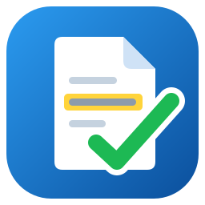

  

<h1 align="center">gr8-pdf</h1>

<b>PDF annotation, made simple.</b> For Windows 10 and 11.

---

## Download

**[⬇ Download the latest version](https://github.com/gr82code/gr8-pdf-release/releases/latest)**, then run **`gr8-pdf-win-Setup.exe`**.

* Installs in seconds for your Windows user, with no administrator rights needed.
* Adds gr8-pdf to the Start menu and opens it straight away.
* Includes everything it needs: there's nothing else to install.

## Automatic updates

gr8-pdf checks for new versions in the background, a few seconds after it starts. When an update is ready, a **Restart to update** button appears at the bottom of the window. Click it when it suits you: gr8-pdf offers to save your work first, then reopens on the new version in about two seconds.

You can also check yourself under **About → Check for updates**, or switch automatic checks off in **Settings → Updates**.

## What it does

* **Annotate any PDF:** text boxes, sticky-note comments, highlights that follow the lines of text, boxes, circles, lines, arrows, ticks and freehand pen.
* **Callouts:** highlight, arrow and comment in one; the arrow stays attached as you move things.
* **Images:** insert, resize, stretch and rotate pictures.
* **Signatures and initials:** a library protected by Windows Hello or a password, which can be burned into the page with a watermark when you save.
* **Text:** select, copy and search text (Ctrl+F).
* **Standard PDF annotations:** your work shows up in Acrobat, Edge, Chrome and other viewers.
* **Sidebar:** page thumbnails, an annotation list, signatures and search.
* **Workflow:** spell check, copy and paste, undo and redo, and remembered styles for each tool.

## System requirements

* Windows 10 (version 1809 or later) or Windows 11, 64-bit.
* Windows Hello is optional (face, fingerprint or PIN for unlocking signatures).

## Uninstall

Use **Settings → Apps → Installed apps → gr8-pdf → Uninstall**. Your settings (`%APPDATA%\gr8-pdf`) are kept in case you reinstall; delete that folder to remove them too.

## Licence

gr8-pdf is commercial software, copyright © gr8Code Limited. All rights reserved. See [LICENSE](LICENSE).
It includes open-source components; their notices are in `THIRD-PARTY-NOTICES.txt` in the install folder and under **About → View third-party notices**.

This repository only hosts the installers and update packages. It contains no source code.
